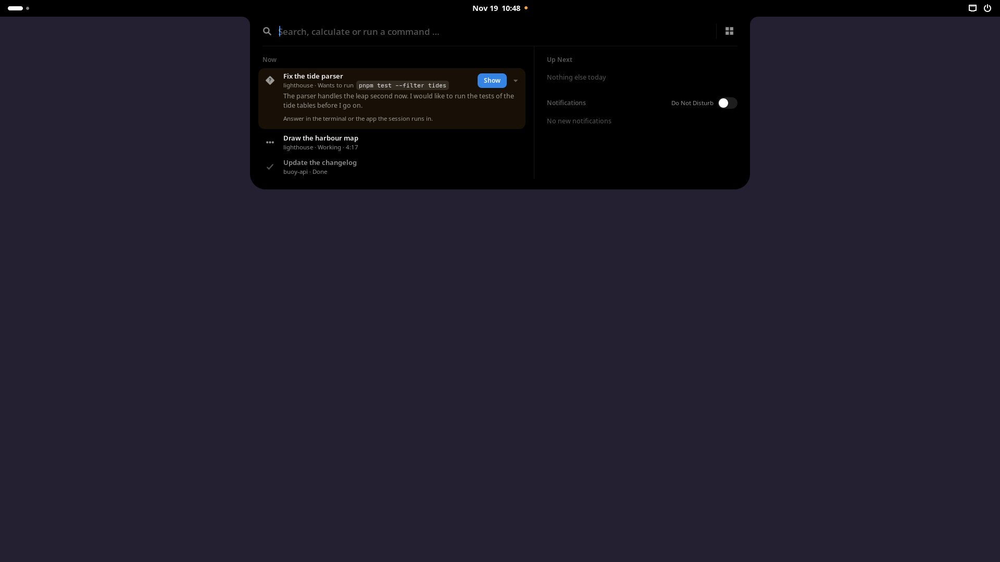
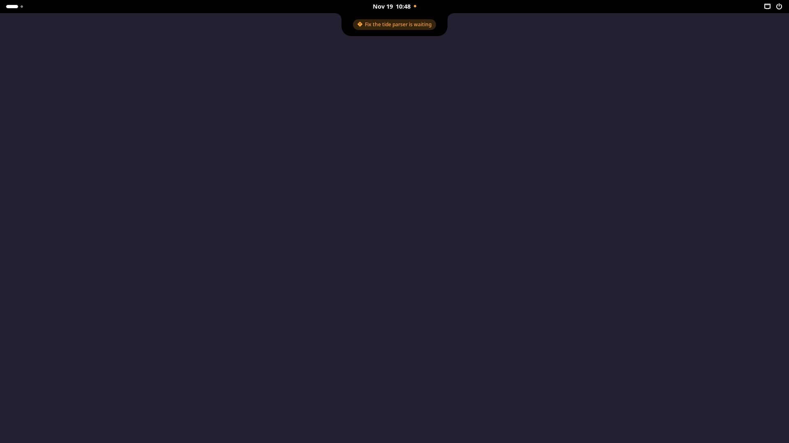

# Visor: Claude Code

**Visor: Claude Code – the Claude Code sessions of this machine in the Visor notch for GNOME**

> Requires [Visor](https://github.com/taulit/visor). Shows what your [Claude Code](https://code.claude.com/docs) sessions are doing, and tells you when one waits for you.



This is a module for [Visor](https://github.com/taulit/visor), the notch for GNOME Shell 50/51. It is a GNOME extension of its own (`visor-claude@taulit.github.io`) and takes one place in Visor: rows in **Now**.

## What it shows

- One row per Claude Code session on this machine that works, waits or has just finished, with the name of the session and its project. Finished sessions leave after two minutes; sessions that only sit there have no row.
- A session that **waits for you** (a permission, a question) turns amber, puts a chip into the peek row and a dot next to the clock, and the notch shows itself briefly (can be turned off). For a permission the row shows the command or the file it is about, when the transcript tells.
- Expand a row to read the last message of the assistant.
- **Show** in a waiting row (and **Show window** in an expanded one) brings the window the session runs in to the front, when it can be told which one it is (see below).

There is nothing to set up. Sessions started in a terminal, by an editor or by another program (T3 Code, for example) all show up, because every Claude Code process keeps the same small file about itself. Without Claude Code on the machine the module shows nothing.



## What it does not do

- **No Allow and no Deny.** Claude Code has no supported way to answer a permission that is already on screen from another program. A hook could answer permissions, but it would have to hold up every permission of every session and wait for a click in GNOME Shell; a click matched to the wrong request would allow a command nobody read. So you answer where the session runs, and Visor only tells you that it waits.
- **No reply and no stop**, for the same reason: there is nothing supported to send them to.
- **The right tab.** "Show window" finds the window through the parents of the Claude Code process. A terminal that runs one process per window (kitty, Alacritty, foot, an editor) is found. GNOME Terminal and Ptyxis keep all their windows in one process: with one window open the button is there, with several it is not, rather than raising the wrong one. Which tab holds the session nobody can tell from outside.
- **What a permission is about is a hint, not a quote.** The module shows the one tool call of the transcript that has no result yet. With several open calls, or a subagent asking, the row just says "Asks for permission".

## Where the data comes from

Claude Code documents no interface for this. The module reads two kinds of files Claude Code keeps for itself below `~/.claude` (or `CLAUDE_CONFIG_DIR`): the session file of each running process (`sessions/<pid>.json`: status, what it waits for, name, directory) and the last 256 kB of the transcript of a session that has a row (`projects/…/<session>.jsonl`: the last message, the title, the open tool call).

**Both formats are undocumented and can change with any Claude Code release.** [docs/data-source.md](docs/data-source.md) lists every field the module relies on, what happens when one is missing, and the version it was read from (2.1.327). A status the module does not know gives no row, never a wrong one.

## Privacy and network

The module has no account, no telemetry and no server. **It makes no network request at all**, and it writes no file.

| What it reads                                | When                                                                                                                                                                     | Turn it off                   |
| -------------------------------------------- | ------------------------------------------------------------------------------------------------------------------------------------------------------------------------ | ----------------------------- |
| `~/.claude/sessions/<pid>.json`              | When a file there changes (one directory monitor, no polling).                                                                                                           | Turn the module off in Visor. |
| The end of `~/.claude/projects/…/<id>.jsonl` | For sessions that have a row: when their status changes, when the panel opens, and every 3 seconds while the panel is open and a session works. At most 256 kB per read. | Turn the module off in Visor. |
| `/proc/<pid>/stat`                           | To see that the process of a session still lives and which window it belongs to; every 30 seconds while a session works or waits.                                        | Turn the module off in Visor. |

A transcript holds what you and the assistant wrote. Of it the module keeps in memory the last message (one line, at most 600 characters), the title and one command or path per waiting session, and shows them in the panel of Visor on this screen: the title and the command in the row, the message only after you expand it. Nothing of it is logged, stored in settings or sent anywhere. The one setting ("Show briefly when a session is waiting") is in GSettings.

## Install

From the [GNOME extension store](https://extensions.gnome.org/) (once released), or from a release ZIP:

```sh
gnome-extensions install --force visor-claude@taulit.github.io.shell-extension.zip
```

Log out and in again on Wayland, then enable the extension. Install and enable Visor as well.

## Build and test

Requires Node 22 or newer, pnpm, `glib-compile-schemas` (libglib2.0-bin), gettext and zip.

```sh
pnpm install
pnpm build      # build/ is an installable extension directory
pnpm pack:zip   # dist/<uuid>.shell-extension.zip, the file for extensions.gnome.org
```

| Script                | Purpose                                                                 |
| --------------------- | ----------------------------------------------------------------------- |
| `pnpm build`          | Compile TypeScript and assemble `build/`                                |
| `pnpm pack:zip`       | Build and create the store ZIP                                          |
| `pnpm lint`           | ESLint and `prettier --check`                                           |
| `pnpm typecheck`      | Type-check with `tsc --noEmit`                                          |
| `pnpm test`           | Unit tests of the parsing and of what becomes a row (Vitest)            |
| `pnpm run test:shell` | The module next to Visor in a sandboxed headless GNOME Shell, see below |
| `pnpm shots`          | The screenshots, from the same sandbox                                  |
| `pnpm pot`            | Regenerate `po/visor-claude.pot` and merge it into `po/*.po`            |
| `pnpm sync:sdk`       | Update `src/visor/` from the npm package `@taulit/visor-module`         |

The shell tests (`tests/shell/`: `prefs`, `claude`, `leak`) use the sandbox of the Visor repository (`scripts/nested.sh`: own HOME, session bus and keyring), so they need a checkout of Visor with `pnpm build` done, at `../visor` or where `VISOR_REPO` points:

```sh
VISOR_REPO=~/src/visor pnpm run test:shell        # all three, about a minute
pnpm run test:shell claude                        # one of them
```

They never touch your `~/.claude`: `tests/shell/fixture.py` writes invented session files and transcripts into the HOME of the sandbox and refuses to run anywhere else, and plain `sleep` processes stand in for Claude Code. No test starts Claude Code. The unit tests use invented lines only.

`src/visor/` holds copies of `connect.js` and the types of `@taulit/visor-module`: a GNOME extension has no `node_modules` at run time and no bundler.

## Gap in the module API

API v1 has no kit element for body text. Like `visor-t3`, this module builds the last message and the hint below it from `St.Label` and colours them through the classes `.visor-dark`, `.visor-light` and `.visor-hc` that Visor sets on its root (`stylesheet.css`). Those classes are not part of the contract; a `kit.text()` would remove the need.

## Not checked

- **A real waiting session was never seen by this module.** That `status` becomes `waiting` and `waitingFor` says why was read from the code of Claude Code 2.1.327; on disk only a working session (`busy`) was observed, and the parser was run against that one real file and the end of its transcript. Everything else ran against invented files in the same shapes.
- That a process removes its session file when it ends, and the meaning of the status `shell`, are read from the code and the state of the folder, not watched happening.
- Other versions of Claude Code than 2.1.327, macOS (no `/proc`, the module would show nothing there; GNOME Shell does not run there anyway), sessions inside a container or over SSH (their pids are not the ones of this machine, so they have no row).
- "Show window" ran against a test window of GTK in the sandbox, not against real terminals. Windows of X11 clients and of sandboxed apps (Flatpak, where the pid of the window may not be the one `/proc` shows) were not tried.
- Whether the transcript always holds the tool call by the time the permission is asked: the module reads it a second time after 0.8 s, and shows no detail if it is still not there.
- The German translation was not checked by a second reader; there are no other languages yet.
- "Claude Code" is the name of a product of Anthropic; whether the store name needs their permission is open. The icon of the catalog entry is a glyph of our own, not their logo.
- The module ran only in the sandbox, never in a logged-in session, and has not been released.

## Release

Push a tag such as `v1.0.0`: the workflow `.github/workflows/release.yml` builds the ZIP and attaches it to a GitHub release. Upload that ZIP to [extensions.gnome.org](https://extensions.gnome.org/upload/) by hand.

`catalog/` holds what would go into [visor-modules](https://github.com/taulit/visor-modules) for this module: the entry and its folder with the icon and two screenshots of 1600×1000.

## License

GPL-2.0-or-later, like Visor.
